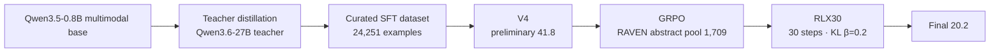

# Qwen Multimodal Reasoning Challenge

<p align="center">
  <a href="README.md"></a>
  <a href="README.en.md"></a>
</p>

> [!IMPORTANT]
> **In one sentence**: teacher-distillation SFT first establishes breadth across six reasoning capabilities, then a 30-step small-dose GRPO update provides a restrained calibration — a public technical archive of the two-stage "V4 → RLX30" post-training pipeline for a 0.8B multimodal model.
>
> **Results**: preliminary V4 **41.8** · final submission RLX30 platform best **20.2** · final-round-protocol baseline V4 18.2 (RL net gain **+2.0**)
>
> **How to use**: this repository is a documentation archive of the method, key hyperparameters and experiment conclusions — no model weights or private data. Reproduction scope and checklist: [📦 Reproduction Scope](#-reproduction-scope) and [docs/reproduction-notes.md](docs/reproduction-notes.md).


---

## 🏆 Results at a Glance

| Item | Result |
|------|--------|
| Preliminary submission V4 | **41.8** (platform score) |
| Final submission RLX30 | **20.2** (platform best) |
| Final-round-protocol baseline | V4-SFT 18.2 |
| RL net gain | **+2.0** |
| Training recipe | Teacher-distillation SFT (LoRA) + 30-step small-dose GRPO |
| Submission engineering | Flat structure + file integrity checks |

> The preliminary and final scores come from different official evaluation protocols and should not be compared directly; within the final-round protocol, the V4 baseline was 18.2.

## 📖 The Challenge

The task requires multimodal reasoning over mixed image-text inputs, spanning six capability dimensions:

- **numeric reasoning** · **counting** · **spatial reasoning** · **physics commonsense** · **perception** · **association**

The model must produce a structured answer format (boxed markers) consistent with the official evaluator; the training reward is strictly aligned with the scoring convention.

## 🧩 Solution Overview



The throughline: **SFT first builds capability breadth and a unified answer format; RL only anchors the compliant preliminary model, making a restrained calibration update.**

## 🧠 Core Modules

### V4 (SFT stage · [`configs/v4-sft.example.yaml`](configs/v4-sft.example.yaml))

| Setting | Value |
| --- | --- |
| Fine-tuning method | LoRA (all-linear) |
| LoRA rank / alpha | 16 / 32 |
| Epochs | 2 |
| Learning rate | 1e-4 |
| Effective batch size | 16 |
| Maximum sequence length | 2,048 |
| Random seed | 42 |
| Preliminary score | **41.8** |

Teacher distillation produced 113,159 usable multimodal instruction examples from a 113,164-image candidate pool; filtering and quality checks yielded 24,251 train_v4 examples.

### RLX30 (GRPO stage · [`configs/rlx30-grpo.example.yaml`](configs/rlx30-grpo.example.yaml))

| Setting | Value |
| --- | --- |
| Algorithm | GRPO (TRL GRPOTrainer) |
| RL pool | 1,709 RAVEN-style abstract reasoning examples |
| Group size K | 8 |
| Training steps | **30** |
| Learning rate | 1e-6 |
| KL coefficient | 0.2 |
| Maximum completion length | 256 |
| Random seed | 42 |
| Final score | **20.2** |

Final-round rules require starting from the preliminary model with no architecture changes and no additional pretrained weights — RLX30 is a fully compliant minimal-update route.

### Reward design

```text
correct and extractable boxed answer  ->  1.00
extractable but incorrect             ->  0.05
missing structured answer             ->  0.00
```

Answer extraction uses reverse search for boxed markers plus bracket-depth counting; the normalization rules handle whitespace, punctuation and full/half-width symbols, keeping training reward aligned with the platform scorer.

## ⚙️ Experiments & Ablations

| Experiment | Score | Observation |
| --- | ---: | --- |
| RLX30 (abstract pool, 30 steps) | **20.2** | Final submission; best configuration |
| RLX10 (10 steps) | 19.2 | Smaller improvement |
| RLX20 (20 steps) | 15.2 | Unstable update |
| RLX50 (50 steps) | 17.8 | Forgetting begins |
| RLX60 (60 steps) | 16.8 | Excessive update |
| Physics-only pool | 18.8 | Weak transfer to the hidden distribution |
| Counting-only pool | 16.4 | Negative result |
| Group size 16 | 16.6 | More within-pool learning, worse generalization |
| Greedy decoding ablation | 16.8 | Platform default sampling matters more |

Three main conclusions:

1. **Smaller doses are more stable** — platform scores do not increase monotonically with steps: 30 steps reached 20.2 as the optimum, while 50/60 steps regressed as the 0.8B model suffered catastrophic forgetting under larger updates.
2. **Distribution match beats surface coverage** — a single-dimension high-concentration RAVEN pool (20.2) outperformed a six-dimension balanced pool (17.8): matching the hidden evaluation distribution matters more than nominal capability coverage.
3. **Inference-side consistency** — at identical weights, greedy decoding scored about 3 points below the platform default sampling; the final submission kept the platform default inference parameters.

## 📦 Reproduction Scope

**Published**: project background, training route, key hyperparameters and experiment conclusions.

**Intentionally excluded** (not uploaded):

- base model weights and the submitted model
- private competition evaluation data
- training images and the full training dataset
- raw uncleaned training logs
- internal server paths, account information and device configuration

Reproduction checklist:

1. Prepare a compatible Qwen multimodal model and legally shareable visual reasoning datasets;
2. Build experiment configurations from the stages and hyperparameters in [docs/technical-plan.md](docs/technical-plan.md);
3. Replace model, data and device paths in the code with local paths;
4. Reproduce the SFT baseline first, then validate the effects of GRPO steps / learning rate / KL coefficient / data pool individually;
5. Use the same answer-extraction and normalization rules for training rewards and evaluation scripts.

> Platform scores come from the organizers' hidden evaluation and repeated submissions carry measurement noise; the scores and conclusions here should be read as records under competition conditions, not as guarantees for other datasets or hardware.

## 📂 Repository Structure

```
.
├── README.md                    # Chinese original of this document
├── README.en.md                 # English version
├── configs/
│   ├── v4-sft.example.yaml      # V4 SFT config (sanitized example)
│   └── rlx30-grpo.example.yaml  # RLX30 GRPO config (sanitized example)
├── docs/
│   ├── technical-plan.md        # finals technical plan summary (Chinese)
│   ├── experiment-table.md      # experiment and ablation records
│   └── reproduction-notes.md    # reproduction and release-scope notes
└── scripts/
    └── README.md                # public script-release boundary
```

## 📚 Technical Documentation

| Document | Content |
|------|------|
| [docs/technical-plan.md](docs/technical-plan.md) | Finals technical plan summary (route / reward / conclusions) |
| [docs/experiment-table.md](docs/experiment-table.md) | Experiment and ablation records |
| [docs/reproduction-notes.md](docs/reproduction-notes.md) | Reproduction and release-scope notes |
| [scripts/README.md](scripts/README.md) | Public script-release boundary |

## 🙏 Acknowledgements & Declaration

- Full competition name: Pazhou Algorithm Competition · AI Large-Model Algorithm Track, "Qwen Cup: Qwen Multimodal Reasoning Challenge".
- Competition data and evaluation remain the property of the organizers; rules and result interpretation rest with them.
- A personal competition archive maintained by [qiuy-ue](https://github.com/qiuy-ue).
