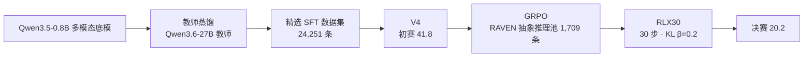

# 千问杯多模态推理挑战赛

<p align="center">
  <a href="README.md"></a>
  <a href="README.en.md"></a>
</p>

> [!IMPORTANT]
> **一句话**：教师蒸馏 SFT 先建立六类能力的宽度，再用 30 步小剂量 GRPO 完成克制校准 —— 0.8B 多模态模型「V4 → RLX30」两阶段后训练方案的公开技术档案。
>
> **成绩**：初赛 V4 **41.8** · 决赛提交 RLX30 平台最高 **20.2** · 决赛口径基线 V4 18.2（RL 净增益 **+2.0**）
>
> **怎么用**：本仓库为方法、关键超参数与实验结论的文档归档，不含模型权重与私有数据；复现范围与检查清单见 [📦 复现范围](#-复现范围) 与 [docs/reproduction-notes.md](docs/reproduction-notes.md)。


---

## 🏆 成果一览

| 项目 | 结果 |
|------|------|
| 初赛提交 V4 | **41.8**（平台成绩） |
| 决赛提交 RLX30 | **20.2**（平台最高成绩） |
| 决赛口径基线 | V4-SFT 18.2 |
| RL 净增益 | **+2.0** |
| 训练方案 | 教师蒸馏 SFT（LoRA）+ 30 步 GRPO 小剂量强化学习 |
| 提交包工程 | 平铺结构 + 文件完整性校验 |

> 初赛与决赛来自不同的官方评测口径，两个分数不应直接比较；决赛口径内 V4 基线为 18.2。

## 📖 赛题与挑战

赛事要求以混合图文输入完成多模态推理，覆盖六类能力维度：

- **数值推理** · **计数** · **空间推理** · **物理常识** · **感知** · **关联推理**

模型需要输出与官方评测器一致的结构化答案格式（boxed 标记），训练奖励与判分口径严格对齐。

## 🧩 方案总览



设计主线：**SFT 先建立六类能力宽度与统一答案格式；RL 只锚定合规的初赛起点，做克制的校准更新。**

## 🧠 核心模块说明

### V4（SFT 阶段 · [`configs/v4-sft.example.yaml`](configs/v4-sft.example.yaml)）

| 参数 | 配置 |
| --- | --- |
| 微调方法 | LoRA（all-linear） |
| LoRA rank / alpha | 16 / 32 |
| 训练轮数 | 2 |
| 学习率 | 1e-4 |
| 有效批大小 | 16 |
| 最大序列长度 | 2,048 |
| 随机种子 | 42 |
| 初赛成绩 | **41.8** |

教师蒸馏从 113,164 张候选图构建出 113,159 条可用多模态指令样本，经过滤与质检后得到 24,251 条 train_v4 训练数据。

### RLX30（GRPO 阶段 · [`configs/rlx30-grpo.example.yaml`](configs/rlx30-grpo.example.yaml)）

| 参数 | 配置 |
| --- | --- |
| 算法 | GRPO（TRL GRPOTrainer） |
| RL 数据池 | RAVEN 九宫格抽象推理 1,709 条 |
| 组大小 K | 8 |
| 训练步数 | **30** |
| 学习率 | 1e-6 |
| KL 系数 | 0.2 |
| 最大生成长度 | 256 |
| 随机种子 | 42 |
| 决赛成绩 | **20.2** |

决赛规则要求以初赛模型为起点、不得修改模型结构或引入其他预训练权重 —— RLX30 是一条完全合规的最小更新路线。

### 奖励设计

```text
正确提取 boxed 答案且匹配   ->  1.00
可提取但答案错误           ->  0.05
无法提取结构化答案         ->  0.00
```

答案提取采用反向查找 boxed 标记与括号深度计数；归一化规则同步处理空白、标点与全半角符号，与平台判分口径保持一致。

## ⚙️ 实验与消融

| 实验 | 分数 | 观察 |
| --- | ---: | --- |
| RLX30（抽象池，30 步） | **20.2** | 最终提交，最优配置 |
| RLX10（10 步） | 19.2 | 增益较小 |
| RLX20（20 步） | 15.2 | 更新不稳定 |
| RLX50（50 步） | 17.8 | 遗忘开始显现 |
| RLX60（60 步） | 16.8 | 更新过度 |
| 物理单维池 | 18.8 | 向隐藏分布迁移弱 |
| 计数单维池 | 16.4 | 负结果 |
| 组大小 16 | 16.6 | 池内学习更多，泛化更差 |
| Greedy 解码消融 | 16.8 | 平台默认采样更重要 |

三条主要结论：

1. **小剂量更稳** —— 平台成绩不随训练步数单调上升：30 步达到 20.2 为最优点，50/60 步回落，0.8B 模型在大更新下出现灾难性遗忘。
2. **分布匹配 > 表面覆盖** —— 单维高浓度 RAVEN 池（20.2）优于六维均衡池（17.8）：RL 数据池与隐藏评测分布的匹配度比覆盖面更关键。
3. **推理侧保持一致** —— 同权重下 greedy 解码比平台默认采样低约 3 分，最终提交保持平台默认推理参数。

## 📦 复现范围

**公开内容**：项目背景、训练路线、关键超参数与实验结论。

**有意排除**（未上传）：

- 基础模型权重与提交模型
- 比赛私有评测集
- 训练图片与完整训练数据
- 未清理的原始训练日志
- 内部服务器路径、账号信息与设备配置

复现检查清单：

1. 准备兼容的 Qwen 多模态模型与公开视觉推理数据集；
2. 按 [docs/technical-plan.md](docs/technical-plan.md) 的阶段划分与超参数建立实验配置；
3. 将代码中的模型、数据与设备路径替换为本地路径；
4. 先复现 SFT 基线，再单独验证 GRPO 步数 / 学习率 / KL 系数 / 数据池的影响；
5. 训练奖励与评测脚本使用相同的答案提取与归一化规则。

> 平台成绩来自赛事方隐藏评测，重复提交存在测量噪声；仓库中的成绩与结论应理解为比赛环境下的记录，不代表在其他数据集或硬件环境中的保证结果。

## 📂 仓库结构

```
.
├── README.md                    # 本文档（简体中文）
├── README.en.md                 # English version
├── configs/
│   ├── v4-sft.example.yaml      # V4 SFT 配置（脱敏示例）
│   └── rlx30-grpo.example.yaml  # RLX30 GRPO 配置（脱敏示例）
├── docs/
│   ├── technical-plan.md        # 决赛技术方案摘要
│   ├── experiment-table.md      # 实验与消融记录
│   └── reproduction-notes.md    # 复现与公开范围说明
└── scripts/
    └── README.md                # 脚本公开边界说明
```

## 📚 技术文档

| 文档 | 内容 |
|------|------|
| [docs/technical-plan.md](docs/technical-plan.md) | 决赛技术方案摘要（路线 / 奖励 / 实验结论） |
| [docs/experiment-table.md](docs/experiment-table.md) | 实验与消融记录 |
| [docs/reproduction-notes.md](docs/reproduction-notes.md) | 复现与公开范围说明 |
| [scripts/README.md](scripts/README.md) | 脚本公开边界说明 |

## 🙏 致谢与声明

- 赛事全称：琶洲算法大赛 AI 大模型算法优选赛「千问杯：千问多模态推理挑战赛」。
- 比赛数据与评测归赛事主办方所有，相关规则与结果解释权在主办方。
- 本仓库为个人参赛档案，由 [qiuy-ue](https://github.com/qiuy-ue) 维护。
