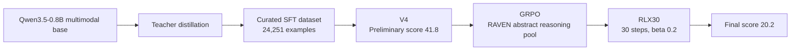

# Qwen Multimodal Reasoning Challenge

> A public technical archive of a two-stage post-training pipeline for the 2026 Qwen Multimodal Reasoning Challenge.

## Overview

This project documents the training decisions, controlled experiments, and release boundaries behind two competition submissions built on a Qwen3.5-0.8B multimodal model.

The system follows a simple division of labor:

1. Teacher distillation and supervised fine-tuning establish broad coverage across six reasoning capabilities.
2. A small GRPO update calibrates the model against a selected, verifiable reasoning signal while keeping the preliminary model as the only starting point.

The public repository contains documentation and sanitized configuration summaries. It does not contain model weights, private evaluation data, original server logs, or the competition submission archives.

## Competition Results

| Submission | Stage | Score | Role |
| --- | --- | ---: | --- |
| **V4** | Preliminary round | **41.8** | SFT model and the compliant starting point for the final-round RL experiments |
| **RLX30** | Final round | **20.2** | V4 followed by a 30-step, small-budget GRPO update |

The two scores come from different official evaluation settings and should not be compared as if they were measured on the same test set. Within the final-round protocol, V4 provided an 18.2-point baseline and RLX30 reached 20.2.

## The Main Idea



The architecture shown in the competition presentation has been redrawn as a public Mermaid diagram. The original presentation is not uploaded.

## Capability Coverage

The evaluation covered six multimodal reasoning dimensions:

- numeric reasoning
- counting
- spatial reasoning
- physics commonsense
- perception
- association

The model receives mixed image-text inputs and produces a structured answer in the format expected by the official evaluator.

## V4: Preliminary SFT System

V4 was the strongest preliminary submission and the only permitted starting point for the final-round RL stage.

The distillation pipeline produced 113,159 usable multimodal instruction examples from a 113,164-image candidate pool. The curated `train_v4` set contained 24,251 examples after filtering and quality checks.

| Setting | Value |
| --- | --- |
| Fine-tuning method | LoRA, all-linear target modules |
| LoRA rank / alpha | 16 / 32 |
| Epochs | 2 |
| Learning rate | 1e-4 |
| Effective batch size | 16 |
| Maximum sequence length | 2,048 |
| Random seed | 42 |
| Preliminary score | **41.8** |

## RLX30: Final GRPO System

RLX30 starts from the V4 submission and applies a deliberately small GRPO update. The goal was calibration rather than a large policy shift, because larger updates caused the 0.8B model to overfit the RL pool and forget broader capabilities.

| Setting | Value |
| --- | --- |
| Algorithm | GRPO |
| RL pool | 1,709 RAVEN-style abstract reasoning examples |
| Group size | 8 |
| Training steps | **30** |
| Learning rate | 1e-6 |
| KL coefficient | 0.2 |
| Maximum completion length | 256 tokens |
| Random seed | 42 |
| Final score | **20.2** |

### Reward design

```text
correct and extractable answer  ->  1.00
extractable but incorrect      ->  0.05
missing structured answer      ->  0.00
```

The answer extractor and normalization rules were aligned with the official evaluation convention.

## Controlled Experiments

| Experiment | Score | Observation |
| --- | ---: | --- |
| RLX30, abstract pool, 30 steps | **20.2** | Best final artifact |
| 10 RL steps | 19.2 | Smaller improvement |
| 20 RL steps | 15.2 | Unstable update |
| 50 RL steps | 17.8 | More forgetting |
| 60 RL steps | 16.8 | Excessive update |
| Physics-only pool | 18.8 | Weak transfer to the hidden evaluation distribution |
| Counting-only pool | 16.4 | Negative result |
| Group size 16 | 16.6 | More within-pool learning, worse generalization |
| Greedy decoding ablation | 16.8 | Sampling was important under the platform protocol |

The main engineering conclusion was that a small model benefits from a constrained RL update anchored to the compliant preliminary model.

## Repository Structure

```text
.
├── README.md
├── configs/
│   ├── v4-sft.example.yaml
│   └── rlx30-grpo.example.yaml
├── docs/
│   ├── experiment-table.md
│   └── reproduction-notes.md
└── scripts/
    └── README.md
```

## Reproduction Scope

This is a technical archive, not a turnkey reproduction package. A full reproduction requires compatible Qwen multimodal checkpoints, legally shareable data, and an accelerator environment.

The following items are intentionally excluded:

- model weights and `model.safetensors`
- private or hidden evaluation data
- original server paths and raw logs
- competition submission ZIP files
- credentials, tokens, and internal endpoints

## Attribution

Maintained as a personal competition archive by [qiuy-ue](https://github.com/qiuy-ue). Competition data and evaluation remain subject to the organizer's rules.
